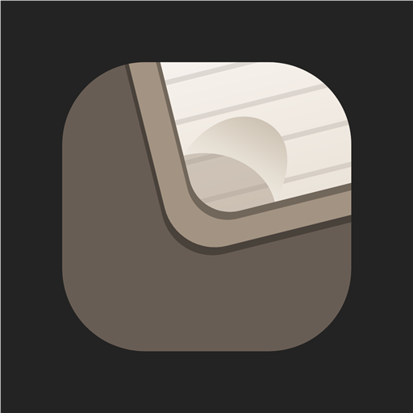

<p align="center">
  
</p>

# CodexVTT

Tool per voice-to-text basato su whisper (https://github.com/openai/whisper).

CodexVTT è un'app Windows che trascrive file audio con modelli Whisper installati ed eseguiti **localmente**: audio e testo non lasciano il PC.

## Struttura

| Percorso | Contenuto |
|---|---|
| `src/CodexVtt.Core` | Dominio: catalogo e selezione modelli, verifica, audio, trascrizione, export, impostazioni, log. Nessuna rete. |
| `src/CodexVtt.Transcription.Whisper` | Adattatore whisper.cpp (Whisper.net), runtime CPU + NoAvx |
| `src/CodexVtt.Audio.Windows` | Decodifica Media Foundation (Windows) |
| `src/CodexVtt.Audio.FFmpeg` | Decodifica con ffmpeg del sistema (Linux/Docker) |
| `src/CodexVtt.Models.Download` | Unico componente con accesso alla rete: download dei modelli con allowlist e SHA-256 |
| `src/CodexVtt.Bridge` | Contratto JSON versionato core ↔ UI e dispatcher dei comandi |
| `src/CodexVtt.App` | Shell .NET MAUI (Windows) con HybridWebView |
| `src/CodexVtt.Updates` | Aggiornamenti dell'app dalle release di GitHub ([ADR-0008](docs/adr/0008-aggiornamenti-da-github.md)) |
| `src/CodexVtt.Server` | Versione server: la stessa UI nel browser, in Docker o come servizio di Windows ([ADR-0007](docs/adr/0007-versione-server.md)) |
| `ui/` | Interfaccia React + TypeScript (Vite) |
| `tests/` | Test unitari, di architettura (isolamento di rete), server, aggiornamenti e integrazione Whisper |
| `scripts/` | `test-locale.ps1` (controlli), `release-locale.ps1` (release), `installa-servizio.ps1` (servizio di Windows) |
| `tools/pin_catalog.py` | Fissa revisione e SHA-256 dei modelli dal repository Hugging Face |

## Sviluppo

```bash
# Core e test (Linux, macOS o Windows)
dotnet test tests/CodexVtt.Core.Tests
dotnet test tests/CodexVtt.Architecture.Tests

# Test con un modello reale (facoltativo)
CODEXVTT_TEST_MODEL=/percorso/ggml-base.bin CODEXVTT_TEST_AUDIO=/percorso/jfk.wav dotnet test tests/CodexVtt.Integration.Tests

# UI nel browser con il core simulato
cd ui && npm ci && npm run dev
npm test

# App Windows (richiede Windows e il workload MAUI)
cd ui && npm run build:app && cd ..
dotnet workload install maui-windows
dotnet build src/CodexVtt.App -c Debug
```

Il repository **non usa GitHub Actions**: i controlli si eseguono dal PC con un solo comando.

```powershell
.\scripts\test-locale.ps1                  # .NET, UI e build dell'app
.\scripts\test-locale.ps1 -Docker -Feed    # in più: immagine Docker con prova del token e feed di aggiornamento reale
```

## Versione server (UI nel browser)

Per le macchine dove la WebView non funziona (VM) o per usare CodexVTT da un altro dispositivo: il core gira come servizio e la UI si apre nel browser; le trascrizioni in coda continuano anche con la pagina chiusa.

**Con Docker (consigliato)** — Linux, funziona ovunque giri Docker, anche in una VM:

```bash
export CODEXVTT_TOKEN="una-frase-lunga-e-segreta"     # PowerShell: $env:CODEXVTT_TOKEN = "..."
docker compose up -d --build
# poi apri http://localhost:5185/?token=una-frase-lunga-e-segreta (una volta sola)
```

Il container include ffmpeg per MP3, M4A, FLAC, OGG… (il WAV si legge senza). Modelli, impostazioni, log e cronologia stanno nel volume `codexvtt-data` (`/data`) e restano agli aggiornamenti; un modello già scaricato si può copiare in `/data/models` (`docker cp ggml-small.bin <container>:/data/models/`) oppure scaricare dalla scheda Modelli. La porta è esposta solo su `127.0.0.1`: per la rete locale cambia in `5185:5185` in `docker-compose.yml`. Il token è obbligatorio, perché dentro il container le richieste non arrivano da localhost.

**Direttamente su Windows:**

```powershell
cd ui; npm ci; npm run build:server; cd ..
dotnet run --project src/CodexVtt.Server        # http://127.0.0.1:5185, solo da questo PC

# Come servizio di Windows, raggiungibile dalla rete locale (PowerShell come amministratore):
.\scripts\installa-servizio.ps1 -Urls "http://0.0.0.0:5185" -Token "una-frase-lunga-e-segreta"
# Rimozione: .\scripts\installa-servizio.ps1 -Disinstalla
```

Dalla rete serve il token: la prima volta apri `http://indirizzo:5185/?token=…`. Il server non fa HTTPS: fuori dalla LAN usa una VPN o un reverse proxy. Impostazioni in `appsettings.json` (sezione `CodexVtt`: `DataRoot`, `HistoryDirectory`, `AccessToken`, `MaxUploadBytes`), sovrascrivibili con variabili `CodexVtt__AccessToken=…`. L'indirizzo si imposta con `Urls` (variabile `Urls=http://0.0.0.0:5185`).

## Rilascio

Dal PC Windows, su `main` aggiornato: `.\scripts\test-locale.ps1 -Docker -Feed`, poi `.\scripts\release-locale.ps1 -DryRun` (costruisce l'installer senza pubblicare) e infine `.\scripts\release-locale.ps1`. Lo script usa `Directory.Build.props` per la versione, `docs/releases/<versione>.md` per le note, scarica le release precedenti per creare i delta e pubblica con `gh release create` installer **e feed degli aggiornamenti**. Servono .NET SDK 10 con il workload `maui-windows`, Node 22, Visual Studio, Git e GitHub CLI autenticata.

## Aggiornamenti

L'app installata cerca le nuove versioni nelle release di GitHub del progetto ([ADR-0008](docs/adr/0008-aggiornamenti-da-github.md)): da **Impostazioni → Aggiornamenti** con «Controlla aggiornamenti», oppure da sola all'avvio se attivi la casella (spenta di default). Non viene inviato nessun dato personale. L'indirizzo del repository è in `src/CodexVtt.Core/ProjectInfo.cs`. Per provare gli aggiornamenti senza GitHub imposta `CODEXVTT_UPDATE_SOURCE` con la cartella di un feed Velopack. Il server in Docker si aggiorna ricostruendo l'immagine (`git pull && docker compose up -d --build`).

## Versioni

Le versioni seguono [SemVer 2.0](https://semver.org/lang/it/) (`X.Y.Z[-fase.N]`), richiesto anche da Velopack. La versione si imposta in `Directory.Build.props` e il tag Git è `v` + versione (es. `v1.0.0-beta.1`).

| Parte | Quando cambia |
|---|---|
| **X** | Cambio di versione significativo. Diventa `1` quando le funzionalità di base sono complete. |
| **Y** | Avanzamento normale tra una versione e l'altra. |
| **Z** | Una correzione di bug per versione (0.2.1, 0.2.2, 0.2.3…), ciascuna su una branch dedicata. |
| **-alpha.N / -beta.N / -rc.N** | Pre-release; senza suffisso la versione è stabile. |

Velopack considera `1.0.1` più recente di `1.0.0`, quindi ogni correzione viene proposta come aggiornamento. Eventuali build di prova (interfacce a tema, funzionalità non ancora integrate) vanno pubblicate su un canale separato (`vpk pack --channel <nome>`).

## Licenza

CodexVTT è distribuito con licenza [Apache-2.0](LICENSE). Le licenze dei componenti di terzi e dei modelli, con le attribuzioni richieste (per esempio CC-BY-4.0 per i modelli NVIDIA), sono in [NOTICE](NOTICE) e in [docs/architecture/licenze.md](docs/architecture/licenze.md).

## Documentazione

- [Specifica di prodotto V1](docs/spec/v1-product-spec.md)
- [Guida utente](docs/guida-utente.md)
- [Decisioni architetturali (ADR)](docs/adr/README.md)
- [Perimetro V1 e non-obiettivi](docs/architecture/perimetro-v1.md)
- [Registro dei rischi](docs/architecture/rischi.md)
- [Matrice licenze](docs/architecture/licenze.md)
- [Spike runtime Whisper](spike/runtime-probe/README.md)
